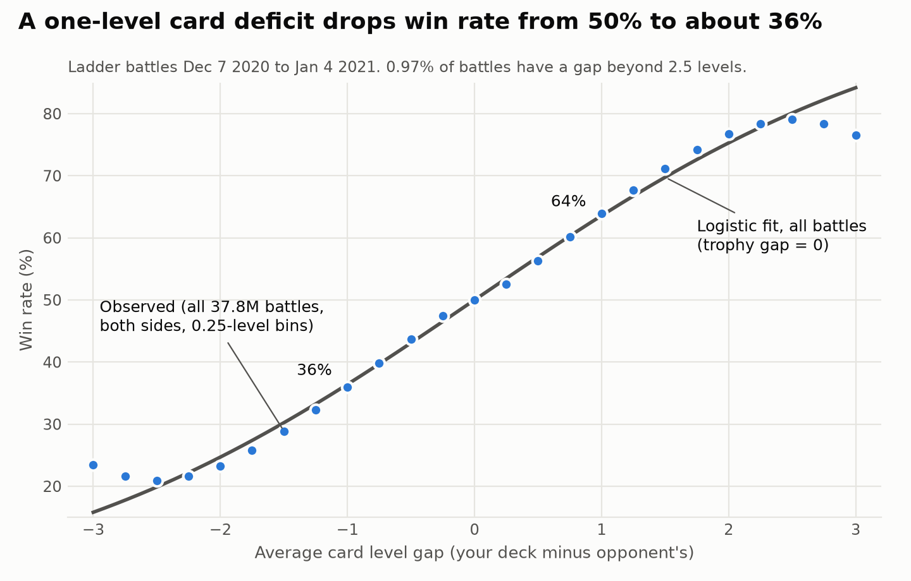
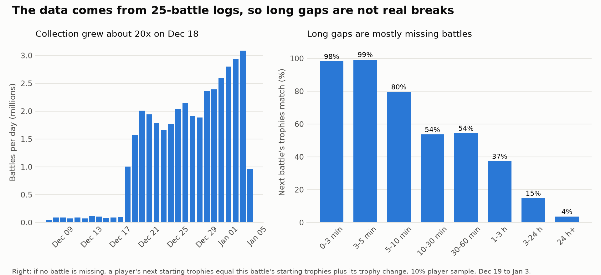
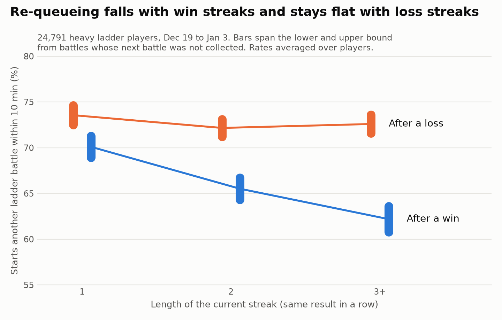
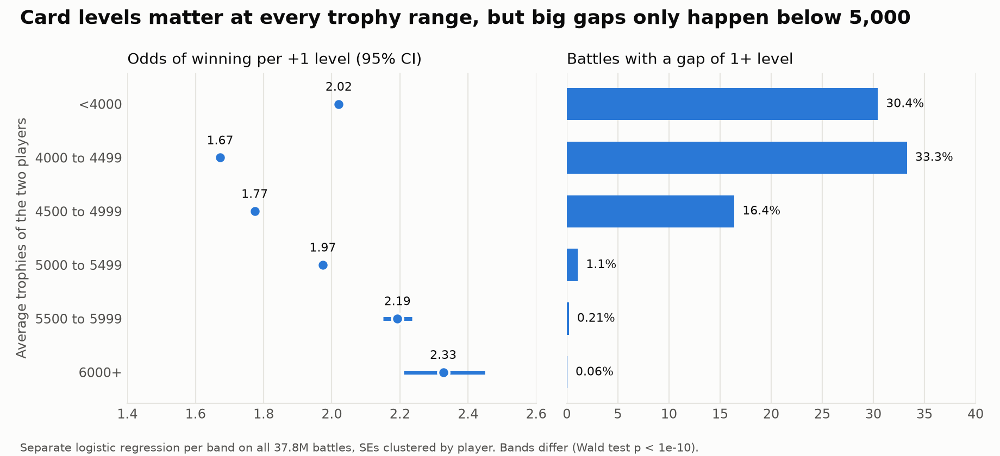

# Clash Royale: does pay-to-win decide matches, and what ends a session?

I've played Clash Royale for about ten years, and some matches felt decided by card levels before they started. So I measured it with 38 million battles.

A product analytics project on 37.8 million Clash Royale ladder battles (Dec 7 2020 to Jan 4 2021). The SQL runs in DuckDB, and the models in statsmodels.

## TL;DR

1. **Card levels decide a large share of matches.** A one-level card deficit cuts a player's chance of winning from 50% to 36%, and about one in four matches below 5,000 trophies has a gap that large.
2. **Heavy players stop after wins, not losses.** After a loss, about 72% start another battle within 10 minutes (bounds 71% to 75%), however many losses in a row. After 1, 2 and 3+ wins in a row, that falls to 69% to 71%, 64% to 67%, and 61% to 64% (lower to upper bound).
3. **The 36% figure probably understates how much cards matter.** At equal trophies, the player with better cards tends to be the weaker player, which hides part of the card advantage. Comparing each player only with themselves raises the effect from 11.2 to 17.7 points of win probability per level, so the 50% to 36% drop is likely an underestimate.

From these, I designed an A/B test of a card level cap in matchmaking: [outputs/phase4_design.md](outputs/phase4_design.md).



---

## The product questions

1. **What ends a play session?** The starting question was whether players quit after losses. If they do, matchmaking that produces lopsided losses costs engagement. The data cannot answer that version (see the audit), so I measured what happens right after wins and losses: does the player queue again?
2. **Does the card level gap decide matches?** In 2020, ladder matchmaking paired players on trophies only, so a player could face an opponent with much stronger cards.

## Data and how it was collected

- **Battles:** 10 daily CSV files with 37,973,387 rows in total, from 2020-12-07 07:00 to 2021-01-04 08:04 UTC. Each row has both players' tags, starting trophies, trophy change, crowns, 8 cards with levels, and the battle time.
- **Reference files:** a card list (102 cards) and a list of win-condition cards.
- **Collection method:** pulled from players' battle logs through the game's API. The evidence is in the audit below.

## Audit findings

Battle-level checks use all rows. Sequence checks use a random 10% of players (1.1 million players) because the window functions over 75 million player-battles do not fit in 8 GB of RAM. Each sampled player keeps their full history.

- **Duplicates.** The battle key is the battle time plus the two players' tags in either order.
  - 169,511 ladder rows were duplicates; 169,509 of them appear in two files because each daily file overlaps the previous one by about 3 hours.
  - After dedupe there are **37,802,265 ladder battles**.
- **Game modes.** Three mode IDs all give about ±29.5 trophies and take turns in time, so I treat all three as ladder. One small mode (1,611 rows, about ±23.5 trophies) is excluded. All data is ladder, so play in other modes is invisible.
- **25-battle log limit.**
  - In ladder, a player's next starting trophies should equal this battle's starting trophies plus its trophy change. When they don't, a battle is missing.
  - Unbroken runs of battles spike at exactly 25 battles: 1,582 runs, against 743 and 530 at the neighboring lengths. 25 is the size of the API's battle log.
- **Long gaps are mostly missing battles** (Dec 19 to Jan 3):

  | Gap to next observed battle | Trophy chain intact |
  |---|---|
  | 3 to 5 min | 99.3% |
  | 10 to 30 min | 53.6% |
  | 3 to 24 hours | 14.8% |
  | 24 hours or more | 3.6% |

- **Missing data depends on the outcome.** For gaps of 1 to 24 hours, the chain is intact 18.0% of the time after a loss and 21.2% after a win. A naive "do players leave after losses" analysis would be biased in the direction of the hypothesis.
- **Collection regime change.** Volume was about 50,000 to 110,000 battles a day until Dec 17, then 1.0 to 3.1 million a day from Dec 18. Analysis of player behavior uses the steady period, Dec 19 to Jan 3.
- **Card levels** are already on the 1 to 13 scale for every rarity. The lowest level seen per card is 1, 3, 6 or 9, which matches the four rarities.
- **Nulls** are structural: tower HP is missing when the tower was destroyed, and clan fields when the player has no clan.



## Question 1: what ends a session? Re-queueing after wins and losses

**What I measured.** Whether a player starts another ladder battle within 10 minutes (30 minutes as a check). The original question, quitting after losses, needs reliable long gaps, which this data does not have.

**Population.** 24,791 players with 50+ battles from Dec 19 to Jan 3 and at least 90% of their trophy chain intact. They played 3,474,399 battles. **These are heavy players whose logs were well captured. The results say nothing about casual players or long-term churn.**

**Handling missing battles with bounds.** Each battle gets one of three labels:

- **Yes:** the next observed battle came within 10 minutes. Even if a battle was missed in between, the player returned within 10 minutes.
- **No:** the next battle came later and the trophy chain is intact, so nothing was missed.
- **Unknown:** everything else. That is 4.3% of battles after a loss and 4.8% after a win.

The lower bound counts unknowns as no and the upper bound counts them as yes.

**Main result.** I compared each player with themselves (rate after losses minus rate after wins), averaged across players, and bootstrapped over players for confidence intervals.

| | Loss minus win | 95% CI | Worst-case bounds |
|---|---|---|---|
| Within 10 min | **+6.50 points** | +6.18 to +6.83 | +1.22 to +11.22 |
| Within 30 min | +5.90 points | +5.60 to +6.20 | +0.96 to +10.21 |

**By streak.** The loss-minus-win gap is +3.57 points after one result, +6.87 after two in a row, and +10.82 after three or more. It does not change direction; it grows. All of the growth comes from wins:

- Re-queueing after losses stays near 72% no matter how many losses in a row: bounds 72.5% to 74.6% after one loss, 71.2% to 73.1% after two, 71.6% to 73.6% after three or more.
- Re-queueing after wins falls with each extra win: bounds 68.9% to 71.3% after one win, 64.3% to 66.7% after two, 60.8% to 63.6% after three or more.

Each range runs from the lower bound (unknown outcomes counted as no) to the upper bound (counted as yes), averaged over players.



**Chasing losses or stopping on a high?** There are no draws, so the loss-versus-win gap alone cannot say whether losses push players to keep going or wins make them stop. The patterns within each outcome lean one way:

- **Chasing** predicts more re-queueing as losses pile up, or when a player falls below their session-start trophies. Neither shows up: being below the session start makes almost no difference (+0.09 points, CI -0.20 to +0.38).
- **Stopping on a high** predicts less re-queueing after good runs. That does show up: after a win that sets a new session high, re-queueing is 7.81 points lower than after other wins (CI -8.09 to -7.55).

New highs and win streaks overlap, so these are not two independent confirmations.

**Robustness**

- **Fatigue.** Controlling for battle position and minutes into the session (player fixed effects, SEs clustered by player) barely changes the results. Win streak 3+ vs 1 goes from -8.12 to -7.92 points; the new-session-high effect from -7.73 to -7.61.
- **Excluding Jan 1 to 3.** The pattern holds, and the streak results stay positive under worst-case bounds. But more outcomes are unknown in December, so **the worst-case bounds on the overall loss-vs-win gap include zero** (-1.80 to +15.84). The estimate from known outcomes is +7.40 points (CI +7.04 to +7.75).

Details: [outputs/phase2_notes.md](outputs/phase2_notes.md).

## Question 2: does the card level gap decide matches?

**Setup.** The level gap is player A's average card level minus player B's. I modeled whether A won with a logistic regression on the level gap and the trophy difference.

**Why sides are random.** The raw data labels winner and loser. If A were always the winner, the model would learn the labeling, not the game. So a hash of each battle decides whether A is the winner or the loser. A wins 49.994% of the time and the intercept is about 0, as a symmetric setup should give.

**All 37.8 million battles are used.** The two inputs take few distinct values, so SQL groups battles into 37,768 cells, and a binomial model on the cells gives the same estimate as a model on every battle. SEs are clustered by player.

**Result**

| Level gap | Win probability |
|---|---|
| -2 | 24.7% |
| -1 | **36.4%** |
| 0 | 50.0% |
| +1 | 63.6% |

- Each level multiplies the odds of winning by 1.75. Trophy differences matter far less, because matchmaking already keeps them small.
- 17.7% of all battles, and 24.0% below 5,000 trophies, have a gap of a full level or more.
- The curve flattens beyond ±2.5 levels, which covers 0.97% of battles.
- Adding deck controls (24 win-condition cards and average elixir cost) on a 5% sample moves the coefficient from 0.56 to 0.60.

**By trophy range.**

- The effect per level differs by band: the odds ratio per level runs from 1.67 (4,000 to 4,499) to 2.33 (6,000+).
- Large gaps almost only happen below 5,000 trophies: 16% to 33% of battles have a gap of a level or more there, against 1.1% or less above. Players above 5,000 mostly have maxed cards.

So the practical problem is below 5,000.



**The skill-bias story.**

- **The mechanism.** Matchmaking pairs players on trophies, and trophies reflect both skill and cards. At equal trophies, the player with better cards is likely the less skilled one.
- **The direction.** Every card advantage comes with a skill disadvantage, so the estimate is **biased toward zero**.
- **The check.** On all 143,117 players with 50+ battles, a linear model gives +11.20 points per level without player fixed effects and **+17.74 points** with them (same players, same rows; fixed effects remove each player's own skill). The estimate grows as the story predicts.
- **What remains.** The opponent's skill bias is still there, so even 17.7 is probably an underestimate. These two numbers come from a different sample and model than the 36.4% headline, so compare them with each other, not with it.

Details: [outputs/phase3_notes.md](outputs/phase3_notes.md).

## Experiment design (summary)

Full design: [outputs/phase4_design.md](outputs/phase4_design.md).

- **Treatment.** Cap the card level gap in matchmaking: at most 0.5 levels for the first 10 seconds in queue, under 1.0 level up to 20 seconds, then no cap. Below 5,000 trophies, the first stage would reject 43.7% of today's pairings and the second 24.0%; above 5,000, almost none.
- **Who is in it.** The main analysis group is players below 5,000 trophies **at enrollment**. The treatment changes who climbs past 5,000, so filtering on trophies during the test would condition on an outcome.
- **Primary metric.** Week-4 retention. Each arm's win rate is 50% by construction, so it cannot be the goal metric.
  - This data cannot measure retention, so its baseline is an assumption: 70%, with 50% and 80% as sensitivity cases.
  - Secondary metrics: matches per day, matches per session (Phase 2 predicts a possible dip), share of 1+ level-gap matches, and win rate of underleveled players.
  - Guardrails: queue time by trophy band, upgrade spending, and early quits.
- **Manipulation check.** The share of 1+ level-gap matches must fall at least 50% (from 24.0% to 12% or less). Otherwise the cap did not bind and the other results do not say much about it.
- **Pre-registered segments.** Underleveled (24.6%), middle (52.1%) and over-leveled (23.2%) players, measured at enrollment. Over-leveled players lose their edge and likely spend the most, so spending and retention are checked inside that segment.
- **Randomization.** Separate matchmaking pools per arm, players randomized, equal sizes (25% / 25% / 50% production).
  - This means treatment and control players never meet.
  - Equal sizes give both arms the same queue-time penalty from the smaller pool.
  - Region-level randomization would inflate variance about 100 times in an illustrative example (ICC 0.001, 100,000 players per region). A switchback design would mix both rules for the same player.
- **Power.**
  - With 1 million players per arm, the minimum detectable effect is 0.18 points on retention (at the assumed 70% baseline). On matches per player per day it is 0.31% to 0.92%, using real variance from this data and CUPED.
  - This dataset alone saw 6.9 million ladder players in one week.
- **Run length.** 5 weeks: 1 week of enrollment plus 4 weeks of follow-up, reported week by week to catch novelty or slow adaptation.
- **Decision.**
  - **Ship** if retention is not worse and the guardrails pass. A short-term dip in matches per session alone does not block shipping.
  - **Iterate** if a guardrail fails.
  - **Kill** if retention or payer retention drops.

## Recommendation for the PM

**What to do.** Run the card level cap test described above, targeted at players below 5,000 trophies. Do not ship it without a test.

**Why.** A one-level card gap turns a fair match into roughly 36/64, and about one in four matches below 5,000 trophies has a gap that large. The effect is large in every trophy band (odds ratio 1.67 to 2.33 per level) and probably understated.

**How confident.**

- High that card gaps strongly predict match outcomes.
- Moderate on the size of the effect, because of the skill bias.
- Low on what fairer matches would do to engagement. The only engagement evidence here covers heavy players and short-term re-queueing, and it points to a possible short-term dip: heavy players keep playing after losses and stop after win streaks.

**Risks**

- Over-leveled players, likely the biggest spenders, lose their edge.
- Queue times rise below 5,000 trophies.
- Matches per session could fall even if retention improves.
- The test is designed to measure all three.

## Limitations

- Ladder battles only. Other modes, purchases, sessions and quits are not in the data.
- **The data cannot show whether players quit after losing.** Battles were collected from 25-battle logs, so most long gaps between a player's battles are missing battles, not breaks: only 3.6% of gaps over 24 hours have an intact trophy chain. Missing battles are also more common after losses. That is why Question 1 measures short-term re-queueing instead.
- The re-queue analysis covers heavy, well-captured players only, and uses bounds for the gaps. It says nothing about casual players or long-term churn.
- Four weeks across the holidays, with a large change in collection volume on Dec 18.
- No account age, king level or tower level, so the level gap effect partly includes tower strength.
- All causal claims are limited to observational data. The within-player designs remove stable player differences, not states that change over time.
- Retention, queue time and spending baselines are assumptions in the design doc. They are not measured.

## Mistakes I caught

1. **A hash bug that put every sampled battle on the same side.** To sample battles and assign sides, I first used DuckDB's multi-argument `hash(key..., 'sample')` and `hash(key..., 'side')`. Those hashes share structure: keeping `hash % 100 < 1` fixed the parity of the side hash, so every sampled battle had "A lost", and the model reported perfect separation. I now hash one concatenated string per purpose, and check that A wins about 50% of the time.
2. **A row-order bug that hid differences between trophy bands.**
   - An earlier version labeled each battle's trophy band by sending the data to pandas and back into DuckDB. With `preserve_insertion_order=false`, the rows came back reordered, and 68.5% got the wrong band.
   - Every band then looked identical (coefficient about 0.56, test p = 0.49), and I reported "the same effect at every trophy range".
   - Rerunning on the full data with bands computed in SQL showed clear differences (odds ratio 1.67 to 2.33). The sign of the bug was that every band showed the same spread of gaps, while gaps should almost vanish above 5,000 trophies.
3. **A hypothesis that pointed the wrong way.** The win-rate curve flattens past 2.5 levels. I considered "deliberately deranked players" as a cause, then dropped it. Those players have both high cards and high skill, so they would make the curve steeper, not flatter. Smurfs (skilled players with weak cards) and over-upgraded players (strong cards, weaker skill) fit. It remains a hypothesis.

## How to reproduce

Python 3.13 on a laptop with 8 GB of RAM. The full run takes about 15 minutes, most of it the one-time CSV conversion.

1. Put the raw files in `$CR_DATA/archive/` (default `CR_DATA=~/cr_data`). Each battle CSV goes in its own folder, as in the original download, with `CardMasterListSeason18_12082020.csv` and `Wincons.csv` at the top of `archive/`. Keep data out of iCloud or other synced folders.
2. Install the packages:

```bash
python -m venv ~/cr_data/.venv && ~/cr_data/.venv/bin/pip install -r requirements.txt
```

3. Run everything in order:

```bash
PYTHON=~/cr_data/.venv/bin/python ./run_all.sh
```

| Step | Script | What it does |
|---|---|---|
| 1 | `src/build_parquet.py` | 10 CSVs to Parquet with a fixed schema |
| 2 | `src/build_battles.py` | Dedupe on the battle key, ladder modes only |
| 3 | `src/audit.py` | Phase 1 audit, writes `outputs/phase1_audit_seq10.txt` |
| 4 | `src/requeue.py` | Phase 2 re-queue analysis and robustness checks |
| 5 | `src/level_gap.py` | Phase 3 models |
| 6 | `src/power.py` | Phase 4 baselines, variances and MDEs |
| 7 | `src/figures.py` | All figures |

`src/config.py` holds paths, the DuckDB settings (memory and spill limits), and the shared `battles` view.

**Which results use samples, and why**

| Result | Data used | Why |
|---|---|---|
| Audit counts, duplicates, card levels | All rows | |
| Audit sequence checks (gaps, chain, 25-battle runs) | 10% of players, full histories | Window functions over 75M player-battles exceed 8 GB |
| Question 1 (re-queue) | All 24,791 well-covered players | |
| Question 2 main and per-band models | All 37.8M battles | |
| Question 2 deck-control check | 5% of battles | 24 extra columns exceed memory at full size |
| Question 2 skill-bias check | All 143,117 players with 50+ battles | |
| Phase 4 inputs | All rows | |
